<!-- Generated from profile.yml and templates/ by src/build.ts. Do not edit by hand. -->

# Alexandr Artemev 

**Full-stack TypeScript developer · web, desktop and mobile**

<picture>
  <source media="(prefers-color-scheme: dark)" srcset="https://readme-typing-svg.demolab.com?font=JetBrains+Mono&weight=500&size=20&pause=1500&center=true&vCenter=true&width=720&height=40&lines=Full-stack%20TypeScript%2C%20from%20the%20database%20to%20the%20app%20store;Strict%20mode%20on%2C%20any%20banned;Rewriting%20my%20Hyprland%20config.%20Again.;btw%2C%20I%20use%20Arch&color=7E9CD8" />
  <source media="(prefers-color-scheme: light)" srcset="https://readme-typing-svg.demolab.com?font=JetBrains+Mono&weight=500&size=20&pause=1500&center=true&vCenter=true&width=720&height=40&lines=Full-stack%20TypeScript%2C%20from%20the%20database%20to%20the%20app%20store;Strict%20mode%20on%2C%20any%20banned;Rewriting%20my%20Hyprland%20config.%20Again.;btw%2C%20I%20use%20Arch&color=4D699B" />
  
</picture>

 

<picture>
  <source media="(prefers-color-scheme: dark)" srcset="./assets/header-dark.svg" />
  <source media="(prefers-color-scheme: light)" srcset="./assets/header-light.svg" />
  
</picture>

 

### Tech stack

<table>
  <tr>
    <td><b>Languages</b></td>
    <td><picture>
        <source media="(prefers-color-scheme: dark)" srcset="https://skillicons.dev/icons?theme=dark&i=ts%2Cjs%2Crust%2Cphp" />
        <source media="(prefers-color-scheme: light)" srcset="https://skillicons.dev/icons?theme=light&i=ts%2Cjs%2Crust%2Cphp" />
        
      </picture></td>
  </tr>
  <tr>
    <td><b>Frontend</b></td>
    <td><picture>
        <source media="(prefers-color-scheme: dark)" srcset="https://skillicons.dev/icons?theme=dark&i=react%2Cnextjs%2Cvue%2Cvite%2Csass" />
        <source media="(prefers-color-scheme: light)" srcset="https://skillicons.dev/icons?theme=light&i=react%2Cnextjs%2Cvue%2Cvite%2Csass" />
        
      </picture></td>
  </tr>
  <tr>
    <td><b>Backend</b></td>
    <td><picture>
        <source media="(prefers-color-scheme: dark)" srcset="https://skillicons.dev/icons?theme=dark&i=nodejs%2Cbun%2Cnestjs%2Cprisma%2Cpostgres" />
        <source media="(prefers-color-scheme: light)" srcset="https://skillicons.dev/icons?theme=light&i=nodejs%2Cbun%2Cnestjs%2Cprisma%2Cpostgres" />
        
      </picture></td>
  </tr>
  <tr>
    <td><b>Platforms</b></td>
    <td><picture>
        <source media="(prefers-color-scheme: dark)" srcset="https://skillicons.dev/icons?theme=dark&i=tauri%2Cgodot%2Cwordpress" />
        <source media="(prefers-color-scheme: light)" srcset="https://skillicons.dev/icons?theme=light&i=tauri%2Cgodot%2Cwordpress" />
        
      </picture></td>
  </tr>
  <tr>
    <td><b>Tooling</b></td>
    <td><picture>
        <source media="(prefers-color-scheme: dark)" srcset="https://skillicons.dev/icons?theme=dark&i=docker%2Cgithubactions%2Cvitest%2Cgit%2Carch" />
        <source media="(prefers-color-scheme: light)" srcset="https://skillicons.dev/icons?theme=light&i=docker%2Cgithubactions%2Cvitest%2Cgit%2Carch" />
        
      </picture></td>
  </tr>
</table>

### Recent commits

<picture>
  <source media="(prefers-color-scheme: dark)" srcset="./assets/activity-dark.svg" />
  <source media="(prefers-color-scheme: light)" srcset="./assets/activity-light.svg" />
  
</picture>

Generated from <a href="./profile.yml">profile.yml</a> by a GitHub Action, refreshed daily.

