<!-- Generated from profile.yml and templates/ by generate.ts. Do not edit by hand. -->
<picture>
  <source media="(prefers-color-scheme: dark)" srcset="./assets/header-dark.svg" />
  <source media="(prefers-color-scheme: light)" srcset="./assets/header-light.svg" />
  
</picture>

<samp>
  <a href="https://t.me/zilero_drag">telegram</a> ·
  <a href="mailto:alexandr.artemev.me@gmail.com">email</a> ·
  <a href="https://career.habr.com/zilero">habr career</a> ·
  <a href="https://leetcode.com/Zilero232/">leetcode</a> ·
  <a href="https://www.weblancer.net/users/nikapr321/">weblancer</a>
</samp>

### Alexandr Artemev

Full-stack developer, mostly TypeScript. These days that means Next.js, NestJS on Bun, PostgreSQL, Tauri for desktop and Expo for phones. I started with WordPress and PHP. On the side: Godot, and an Arch config I keep rebuilding.

### Projects

<table>
  <tr>
    <td valign="top" width="50%">

**Products**

- **[GnomeVPN](https://github.com/Zilero232/GnomeVPN)** VPN on Hysteria2 for web, desktop and Android
- **[Chatovo](https://github.com/Zilero232/Chatovo)** Desktop voice and video rooms on Tauri + LiveKit
- **[DurakMaster](https://github.com/Zilero232/DurakMaster)** Online Durak for Android, iOS and web from one Expo codebase

</td>
    <td valign="top" width="50%">

**Tooling**

- **[commit-jazzer](https://github.com/Zilero232/commit-jazzer)** Interactive CLI for structured commit messages
- **[gulp-plugins-hub](https://github.com/Zilero232/gulp-plugins-hub)** Monorepo of Gulp plugins
- **[dev-config-hub](https://github.com/Zilero232/dev-config-hub)** Shared ESLint and Prettier configs
- **[pure-flow-ai](https://github.com/Zilero232/pure-flow-ai)** Text moderation and sentiment analysis

</td>
  </tr>
  <tr>
    <td valign="top" width="50%">

**Linux**

- **[arch-install-kit](https://github.com/Zilero232/arch-install-kit)** ★ 55 Arch + Hyprland in one command, Kanagawa dotfiles

</td>
    <td valign="top" width="50%">

**WordPress**

- **[wp-swift-pwa](https://github.com/Zilero232/wp-swift-pwa)** Turns a WordPress site into an installable PWA
- **[wp-storybook-gutenberg](https://github.com/Zilero232/wp-storybook-gutenberg)** Storybook for Gutenberg blocks

</td>
  </tr>
</table>

### Now

<table>
  <tr>
    <td><samp>building</samp></td>
    <td>GnomeVPN and Chatovo</td>
  </tr>
  <tr>
    <td><samp>learning</samp></td>
    <td>Rust for the Tauri side, Godot 4</td>
  </tr>
  <tr>
    <td><samp>running</samp></td>
    <td>Arch Linux, Hyprland, Kanagawa</td>
  </tr>
</table>

### GitHub

<samp>Since 2020 · 12 public repos · ★ 69 · 157 pull requests · 941 contributions in the last year</samp>

<picture>
  <source media="(prefers-color-scheme: dark)" srcset="./assets/snake-dark.svg" />
  <source media="(prefers-color-scheme: light)" srcset="./assets/snake-light.svg" />
  
</picture>

Generated from <a href="./profile.yml">profile.yml</a> by a GitHub Action, refreshed daily.

