<!-- Generated from profile.yml and templates/ by generate.ts. Do not edit by hand. -->
<picture>
  <source media="(prefers-color-scheme: dark)" srcset="./assets/header-dark.svg" />
  <source media="(prefers-color-scheme: light)" srcset="./assets/header-light.svg" />
  
</picture>

<samp>
  <a href="https://t.me/zilero_drag">telegram</a> ·
  <a href="mailto:alexandr.artemev.me@gmail.com">email</a> ·
  <a href="https://career.habr.com/zilero">habr career</a> ·
  <a href="https://leetcode.com/Zilero232/">leetcode</a> ·
  <a href="https://www.weblancer.net/users/nikapr321/">weblancer</a>
</samp>

### Alexandr Artemev

Full-stack developer, mostly TypeScript. These days that means Next.js, NestJS on Bun, PostgreSQL, Tauri for desktop and Expo for phones. I started with WordPress and PHP. On the side: Godot, and an Arch config I keep rebuilding.

  <picture>
    <source media="(prefers-color-scheme: dark)" srcset="./assets/activity-dark.svg" />
    <source media="(prefers-color-scheme: light)" srcset="./assets/activity-light.svg" />
    
  </picture>
  <picture>
    <source media="(prefers-color-scheme: dark)" srcset="./assets/stack-dark.svg" />
    <source media="(prefers-color-scheme: light)" srcset="./assets/stack-light.svg" />
    
  </picture>

Generated from <a href="./profile.yml">profile.yml</a> by a GitHub Action, refreshed daily.

